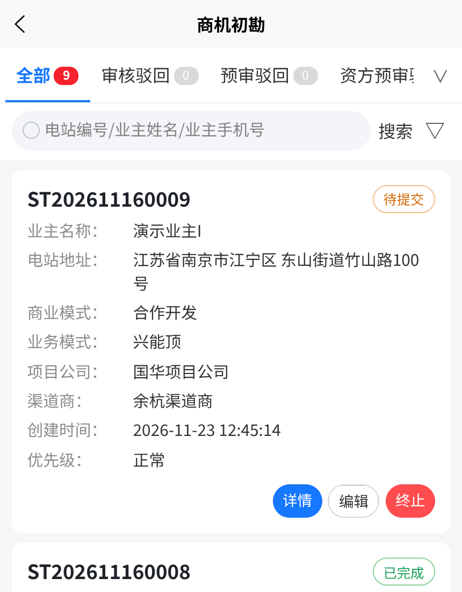

# 商机初勘

## 这个模块干什么

在已有业主上建立电站商机，登记业务模式、上网方式、地址和现场初勘资料，提交后进入审核。审核通过后，流程开启电站勘察。

## 谁来用

开发经理（如 `sales`、`salesjs`）新建并提交。审核员在审核中心办理通过或驳回。

## 从哪里进入

- 现场端：「应用」→「电站开发」→「商机初勘」。右下角「＋」新建。
- 电脑端：首页或「开发/交付」中的「商机初勘」。

*图：现场端商机初勘列表。待提交为橙色，已完成为绿色。待提交行有「详情」「编辑」「终止」。*

## 操作步骤

1. 点「＋」新建，先选择业主。
2. 填写商机信息。必填项通常包括：业务模式、电站类型、上网方式、EPC 方、电站地址和详细地址。当前上网方式请选择 **全额上网**。
3. 按页面补全业主其他信息（接入方式、邻里纠纷、居民用电户号、初勘定位等）以及要求的现场照片，例如居民用电电表照片、正大门照片、主房房屋整体照片。房产证、收益分享账号、共签人等按实际需要填写。
4. 必填项未完成就提交时，系统会提示「不满足限制提交条件：请填写…」，按提示补全后再提交。
5. 点「保存」可先存为待提交；确认无误后提交。提交成功后，页面会提示已进入审核中心。

电脑端同样可以新建和提交。

## 状态与按钮

页签包括全部、审核驳回、待提交、撤回待提交、待审核、已完成、关闭等。列表里还可能出现预审、查容、风控等页签，当前主流程一般使用待提交、待审核、已完成、审核驳回和关闭。

| 状态 | 常见按钮 | 说明 |
| --- | --- | --- |
| 待提交、撤回待提交 | 详情、编辑、终止 | 可继续改并提交。待提交为橙色 |
| 待审核 | 详情 | 已进入审核，不能再改 |
| 审核驳回 | 详情、编辑、终止 | 驳回为橙色。修改后重新提交，将从第一个审批节点开始 |
| 已完成 | 详情 | 已完成为绿色，不能再改 |
| 关闭 | 详情 | 已终止或关闭 |

没有写权限时，即使单据仍是待提交，也只能查看，不能编辑或提交。

筛选和搜索会真正拦住列表，不会只改页签却仍显示全部单据。

## 提交之后会发生什么

- 若该单据的审批在「审批设置」中为启用，状态变为「待审核」（过程中可能同时标出当前审批节点），并出现在审核中心「待我审核」。审核员通过后，单据变为「已完成」，系统生成电站勘察单和相应工单。
- 若该审批已被停用，新提交的单据会直接变为「已完成」，操作日志记为「审批已停用，自动通过」，下游勘察随之开启。改动只影响之后新提交的单据。
- 当前审批节点在所选范围内找不到可用审批人时，系统会提示「无可用审批人，单据仍可提交」。提交后仍进入待审核，需要管理员检查审批设置。

## 注意事项

- 不要把「自发自用」等尚未作为正式选项开放的上网方式写进操作习惯里，当前请使用全额上网。
- 现场环境视频等为选填或可用照片代替的项，以页面提示为准。
- 演示环境里若出现「填入示例取证」「使用示例定位」一类按钮，只是演示辅助，不能当作正式步骤。正式办理请在现场真实定位并拍照。
