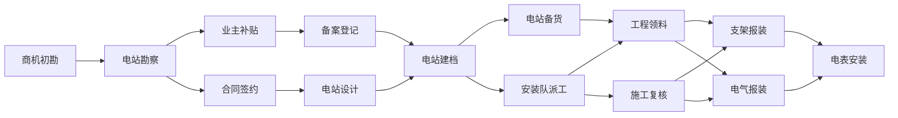

# 快速上手

这份说明介绍如何在 **国华光伏建设管理系统** 中办理户用分布式光伏业务。请先登录，再按职责进入对应模块。

## 建议走一遍的主路径

下面是一条完整的主路径，用来理解各环节如何衔接。请按职责分别办理，不要由同一个人包办所有单据。

1. 开发经理登录现场端或电脑端，在 [业主管理](/owner/owner.html) 中新建业主，再在 [商机初勘](/owner/opportunity.html) 中建单并提交。
2. 审核员在 [审核中心](/audit/audit.html) 通过初勘。通过后系统开启 [电站勘察](/survey/survey.html)。
3. 现勘员完成定位、拍照并提交勘察；审核通过后，[业主补贴](/survey/subsidy.html) 与 [合同签约](/survey/contract.html) 同时开启。
4. 开发经理办理补贴和签约。补贴通过后开启 [备案登记](/survey/filing.html)；签约通过后开启 [电站设计](/design/design.html)。
5. 设计师在电站设计列表中先接单，再填写并提交。备案和设计都通过后，开启 [电站建档](/design/archive.html)。
6. 项目经理办理建档。建档通过后，[电站备货](/design/stock.html) 与 [安装队派工](/install/dispatch.html) 同时开启。
7. 仓储办理备货；安装队负责人新建派工批次并提交。备货通过后开启 [工程领料](/install/pick.html)，但领料必须等派工完成才能提交。
8. 派工通过后开启 [施工复核](/install/review.html)；复核通过且领料完成后，才能提交 [支架报装](/install/bracket.html) 和 [电气报装](/install/electric.html)。
9. 支架和电气都完成后，开启 [电表安装](/install/meter.html)。完工自检以电气报装中的 PDF 上传完成，见 [完工自检](/install/selfcheck.html)。

[产权证明](/property/property.html) 和 [消缺工单](/property/defect.html) 是电站开发中的独立模块，不作为上述主路径的必经闸门。[安全打卡](/install/dispatch.html#安全打卡) 跟随已派工的电站，不参与领料、复核、报装的开启或限制提交。

实线表示「开启条件」：前一环节完成后，系统才会生成并打开下一张单。部分环节还有「限制提交」：例如领料在派工完成前不能提交，支架和电气在领料完成前不能提交。电站详情的流程信息里可以切换查看这两类条件。

## 两端入口

| 端 | 演示地址 | 适合做什么 |
| --- | --- | --- |
| 电脑端 | [https://admin.yuhuisoft.cn/](https://admin.yuhuisoft.cn/) | 审核、查询、系统配置、集中办理 |
| 现场端 H5 | [https://h5.yuhuisoft.cn/](https://h5.yuhuisoft.cn/) | 现场登记、定位打卡、拍照、提交 |

也可以用手机扫描下面的二维码进入对应入口。

::: qr
电脑端 | https://admin.yuhuisoft.cn/ | ../images/qr-admin-yuhuisoft.png
现场端 | https://h5.yuhuisoft.cn/ | ../images/qr-h5-yuhuisoft.png
:::

租户名称填写 **国华光伏建设管理系统**。登录步骤见 [登录与两端](/start/login.html)。

## 读这份说明的方法

- 每一章都按同一结构来写：这个模块干什么、谁来用、从哪里进入、怎么一步步操作、列表上有哪些状态和按钮、提交之后会发生什么、使用时要注意什么。
- 文中配图来自当前演示环境，界面上的业主、地址、证件号等为演示数据。请按实际业务填写，不要照抄。
- 只写当前已经能用的操作。尚未开放的能力集中在 [当前未开放的能力](/appendix/not-open.html)，不要把那些功能当成已经开通。
